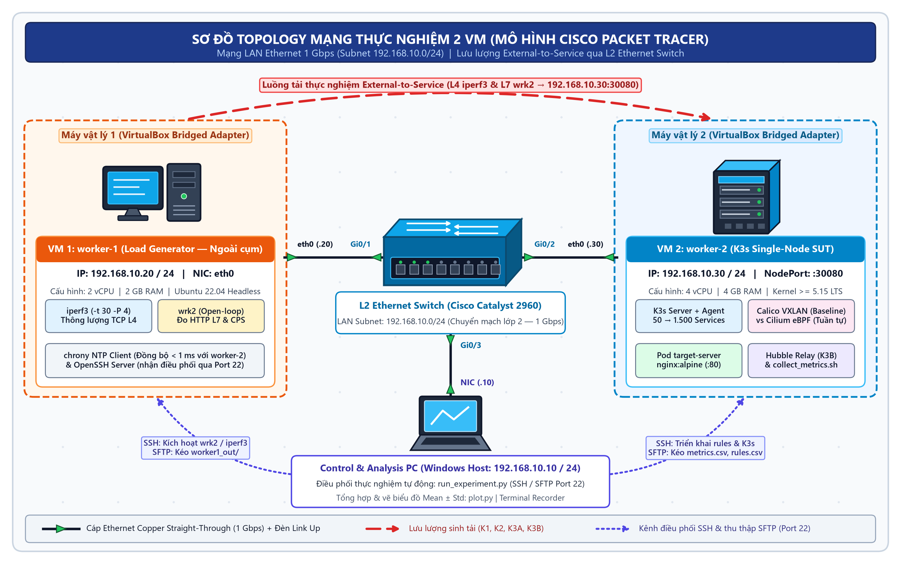
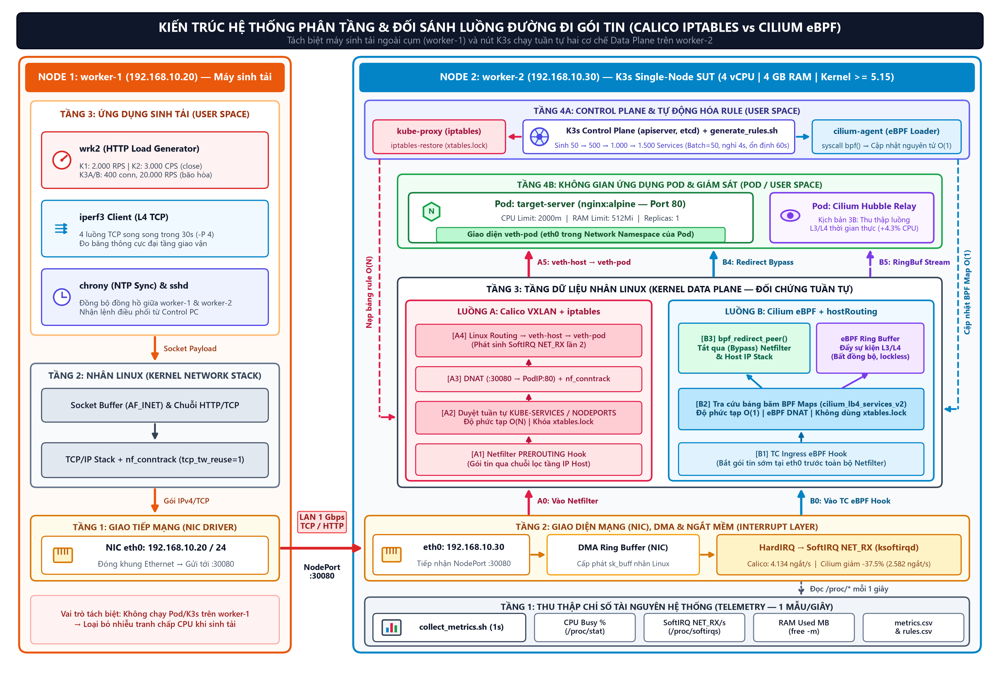
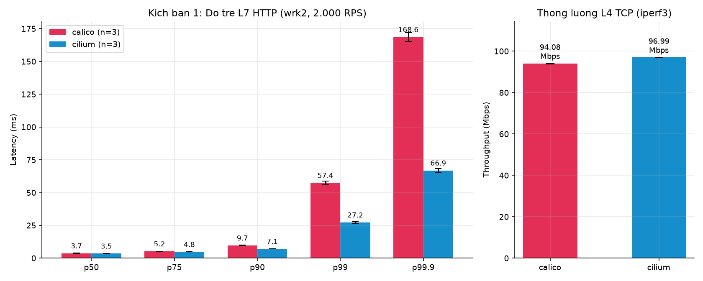
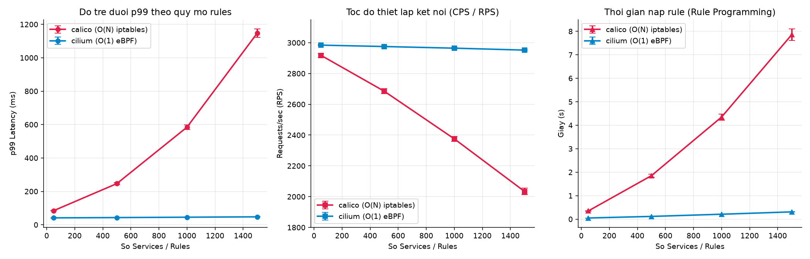
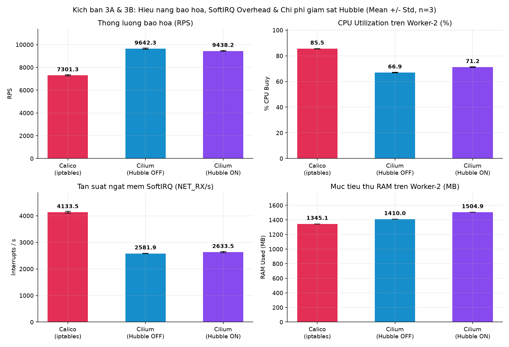
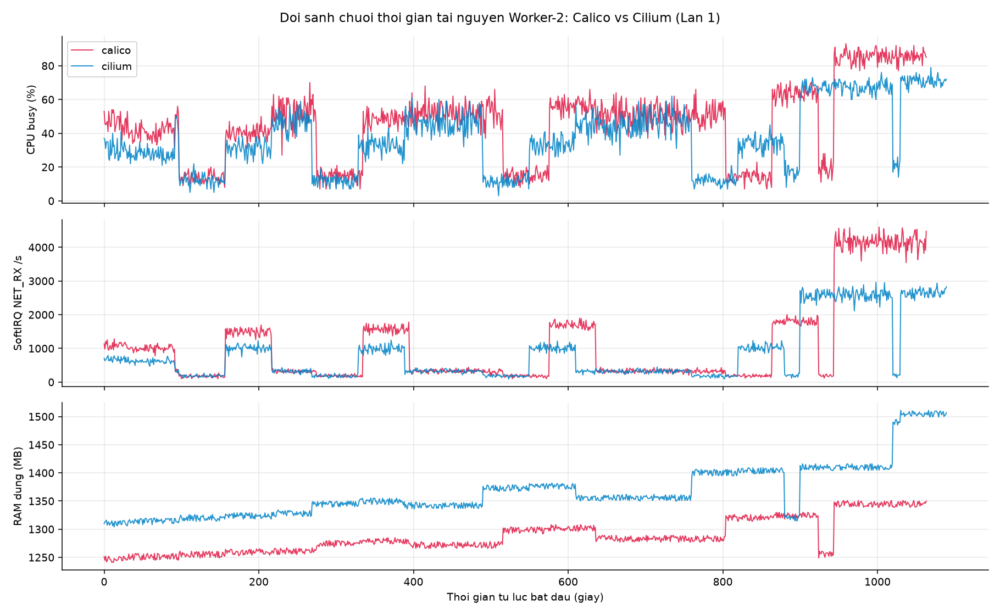

# Đánh giá hiệu năng và khả năng giám sát mạng Cloud-Native dựa trên công nghệ eBPF trong môi trường Kubernetes

> **Đồ án môn học:** `NT531` — Đánh giá hiệu năng hệ thống mạng máy tính  
> **Trường:** Đại học Công nghệ Thông tin, ĐHQG-HCM (UIT) — Khoa Mạng máy tính và Truyền thông  
> **Giảng viên hướng dẫn:** Đặng Lê Bảo Chương  
> **Sinh viên thực hiện:**
> - Phạm Hoàng Quân (`21522501`)
> - Phan Như Thuần (`24521744`)
> - Lê Văn Thiết (`24521674`)

---

## 1. Giới thiệu tổng quan

Kho lưu trữ này chứa toàn bộ mã nguồn điều phối thực nghiệm, tập lệnh tự động hóa, dữ liệu đo đạc thô (`n = 3` vòng lặp độc lập cho mỗi kiến trúc) và mã nguồn phân tích/vẽ biểu đồ phục vụ nghiên cứu đối chứng giữa hai cơ chế **Network Data Plane** trong Kubernetes (**K3s**):

1. **Mô hình nền (Baseline):** **Calico CNI (VXLAN) + `kube-proxy` chế độ `iptables`** (Netfilter tuyến tính $O(N)$, cập nhật toàn cục giữ khóa `xtables.lock`).
2. **Mô hình tối ưu (eBPF-Optimized):** **Cilium CNI (VXLAN) + `kube-proxy-replacement=true` + `bpf.hostRouting=true` + Hubble** (tra cứu bảng băm BPF Hash Maps $O(1)$, cắt tắt đường đi qua `bpf_redirect_peer()`, quan sát luồng bất đồng bộ qua eBPF Ring Buffer).

Toàn bộ chiến dịch đo kiểm được thực thi qua 4 kịch bản chuẩn hóa (`K1`, `K2`, `K3A`, `K3B`), áp dụng bộ sinh tải vòng mở `wrk2` để loại bỏ sai số *Coordinated Omission* và thu thập chuỗi thời gian tài nguyên (`CPU%`, `SoftIRQ NET_RX/s`, `RAM MB`) trực tiếp từ `/proc` ở tần suất 1 mẫu/giây (`6.462` mẫu dữ liệu qua 6 phiên đo).

---

## 2. Topology mạng và Kiến trúc phân tầng hệ thống

Để loại bỏ hoàn toàn nhiễu tranh chấp CPU từ tiến trình sinh tải lên hệ thống được kiểm thử (SUT), hạ tầng thực nghiệm được cô lập theo mô hình 2 máy ảo trên hai máy vật lý kết nối qua **L2 Ethernet Switch (Cisco Catalyst 2960)** thuộc phân mạng `192.168.10.0/24`:

- **`worker-1` (`192.168.10.20`):** Máy sinh tải nằm **ngoài cụm K3s** (2 vCPU, 2 GB RAM, Ubuntu 22.04 Headless), chạy `iperf3`, `wrk2` và đồng bộ đồng hồ `chrony`.
- **`worker-2` (`192.168.10.30`):** Cụm **K3s Single-Node SUT** (4 vCPU, 4 GB RAM, Ubuntu 22.04 Kernel $\ge 5.15$), cài đặt tuần tự Calico và Cilium, triển khai Pod đích `target-server` (`nginx:alpine`, giới hạn `2000m CPU / 512Mi RAM`, mở cổng `NodePort :30080`) và script giám sát `/proc`.
- **Control & Analysis PC (`192.168.10.10`):** Máy tính điều phối Windows chạy `run_experiment.py` (qua SSH/SFTP Port 22) và tổng hợp biểu đồ bằng Python.

### Sơ đồ Topology mạng thực nghiệm



### Kiến trúc phân tầng và Luồng đi gói tin (`Calico iptables` vs `Cilium eBPF`)



---

## 3. Cấu trúc kho lưu trữ

```text
.
├── README.md                          # Tài liệu hướng dẫn và tổng hợp kết quả thực nghiệm
├── .gitignore                         # Loại trừ khóa SSH, cache Python và tệp nháp tạm thời
├── run_experiment.py                  # Điều phối thực nghiệm từ xa qua SSH/SFTP (Paramiko)
├── record_run.py                      # Ghi terminal.log và quay video MP4 quá trình chạy thực nghiệm
├── plot.py                            # Phân tích log, tính Mean ± Std (n=3) và vẽ biểu đồ đối chứng
├── generate_diagrams.py               # Mã nguồn Python vẽ sơ đồ Topology và Kiến trúc phân tầng
│
├── scripts/                           # Bộ công cụ triển khai & sinh tải trên worker-1 / worker-2
│   ├── target-app.yaml                # Deployment target-server (nginx:alpine) & Service NodePort :30080
│   ├── client-pod.yaml                # Mẫu Pod benchmark-client (dự phòng kiểm thử nội cụm)
│   ├── generate_rules.sh              # Tạo 50 -> 1.500 Services theo lô (BATCH_SIZE=50, nghỉ 4s) & đo program_s
│   ├── collect_metrics.sh             # Đọc /proc/stat, /proc/softirqs, free -m xuất CSV chu kỳ 1s
│   └── run_benchmark.sh               # Thực thi tải K1 (iperf3 + wrk2), K2 (Connection: close) & K3 (bão hòa)
│
└── results/                           # Dữ liệu đo đạc gốc và kết quả tổng hợp (n=3 mỗi CNI)
    ├── calico_20261111_162002/        # Calico - Lần đo 1/3 (metrics.csv, rules.csv, phases.csv, logs, mp4)
    ├── calico_20261111_164215/        # Calico - Lần đo 2/3
    ├── calico_20261111_170430/        # Calico - Lần đo 3/3
    ├── cilium_20261112_150425/        # Cilium - Lần đo 1/3 (bao gồm cả pha K3B Hubble ON)
    ├── cilium_20261112_152640/        # Cilium - Lần đo 2/3
    ├── cilium_20261112_154855/        # Cilium - Lần đo 3/3
    └── compare/                       # Tổng hợp Mean ± Std, biểu đồ đối chứng và sơ đồ kiến trúc
        ├── summary.json               # Dữ liệu tổng hợp JSON đầy đủ cho từng lần chạy và Mean ± Std
        ├── summary.md                 # Tóm tắt nhanh các chỉ số chính
        ├── BAO_CAO_KET_QUA_THUC_NGHIEM.md
        ├── k1_latency.png             # Biểu đồ Kịch bản 1 (L4 Throughput & L7 Latency)
        ├── k2_scale.png               # Biểu đồ Kịch bản 2 (50 -> 1.500 Rules: p99, CPS, program_s)
        ├── k3_overhead_and_hubble.png # Biểu đồ Kịch bản 3A & 3B (Bão hòa & Chi phí Hubble)
        ├── timeline_compare.png       # Biểu đồ chuỗi thời gian toàn phiên (CPU%, SoftIRQ, RAM)
        ├── fig_topology.png           # Sơ đồ Topology mạng thực nghiệm
        └── fig_system_architecture.png# Sơ đồ kiến trúc phân tầng và đường đi gói tin
```

Mỗi thư mục trong `results/calico_*` và `results/cilium_*` đều lưu trữ đầy đủ các hiện vật gốc:
- `metrics.csv`, `phases.csv`, `rules.csv`: Chuỗi thời gian tài nguyên `worker-2` và thời gian lập trình quy tắc.
- `worker1_out/`: Kết quả đầu ra nguyên bản từ `iperf3` (`.json`) và `wrk2` (`.txt`) tại `k1`, `k2_50`, `k2_500`, `k2_1000`, `k2_1500`, `k3`, `k3b`.
- `terminal.log`, `terminal_recording.mp4`, `timeline_and_metrics.png`: Nhật ký dòng lệnh, video ghi hình thực thi và biểu đồ đơn phiên.

---

## 4. Hướng dẫn cài đặt và tái lập thực nghiệm

### 4.1. Yêu cầu môi trường trên máy điều phối (Control PC)

```bash
pip install paramiko matplotlib pillow imageio-ffmpeg
```

### 4.2. Chuẩn bị hai nút thực nghiệm (`worker-1` & `worker-2`)

1. Đồng bộ thời gian NTP bằng `chrony`, tắt GUI và tắt swap (`swapoff -a`).
2. Tinh chỉnh tham số nhân Linux trong `/etc/sysctl.d/k8s.conf` trên cả hai máy:
   ```ini
   net.bridge.bridge-nf-call-iptables  = 1
   net.ipv4.ip_forward                 = 1
   net.netfilter.nf_conntrack_max       = 1048576
   net.ipv4.tcp_fin_timeout            = 15
   net.ipv4.tcp_tw_reuse               = 1
   net.core.somaxconn                  = 32768
   ```
3. Trên `worker-2`, cài đặt K3s tuần tự cho từng pha đo:
   - **Pha Calico Baseline:** Cài K3s giữ nguyên `kube-proxy` (`--flannel-backend=none --disable-network-policy`), triển khai Calico `v3.26.1` ở chế độ `CALICO_IPV4POOL_VXLAN=Always`, và áp dụng `kubectl apply -f scripts/target-app.yaml`.
   - **Pha Cilium eBPF:** Gỡ sạch cụm cũ bằng `/usr/local/bin/k3s-uninstall.sh`, cài lại K3s với cờ `--disable-kube-proxy`, sau đó cài Cilium `v1.14.4` qua Helm với `--set kubeProxyReplacement=true --set routingMode=tunnel --set tunnelProtocol=vxlan --set bpf.hostRouting=true`.

### 4.3. Thực thi đo đạc, ghi hình và tổng hợp biểu đồ

```bash
# 1. Chạy thực nghiệm tự động (ví dụ trên cụm Calico hoặc Cilium) kèm quay video terminal
set W1_PASS=<mat_khau_worker1>
python record_run.py results/run_calico python -u run_experiment.py calico

# 2. Hoặc chạy trực tiếp script điều phối
python -u run_experiment.py cilium

# 3. Vẽ biểu đồ đối chứng tổng hợp Mean ± Std từ 3 lần lặp mỗi CNI vào results/compare/
python plot.py results/calico_* results/cilium_*

# 4. Tái tạo hai sơ đồ Topology & System Architecture
python generate_diagrams.py
```

---

## 5. Tổng hợp kết quả thực nghiệm (`Mean ± Std`, `n = 3`)

Chi tiết số liệu đầy đủ lưu tại [`results/compare/summary.json`](results/compare/summary.json) và [`results/compare/BAO_CAO_KET_QUA_THUC_NGHIEM.md`](results/compare/BAO_CAO_KET_QUA_THUC_NGHIEM.md).

### Kịch bản 1: Hiệu năng nền tầng L4 (`iperf3`) và Độ trễ L7 HTTP (`wrk2`, `2.000 RPS`)

| Chỉ số đo lường | Calico (`iptables`) | Cilium (`eBPF`) | Chênh lệch ($\Delta\%$) |
| :--- | :---: | :---: | :---: |
| **Thông lượng L4 (`iperf3 -P 4`)** | `94,08 ± 0,23` Mbps | **`96,99 ± 0,15` Mbps** | **`+3,1%`** |
| **Ngắt mềm `NET_RX` SoftIRQ K1** | `1.036,6` ngắt/s | **`634,6` ngắt/s** | **`-38,8%`** |
| **CPU trung bình K1 (`worker-2`)** | `42,76%` | **`28,46%`** | `-14,30` điểm % |
| **Độ trễ trung vị `p50`** | `3,74 ± 0,06` ms | **`3,51 ± 0,04` ms** | `-6,2%` |
| **Độ trễ phân vị `p90`** | `9,66 ± 0,21` ms | **`7,13 ± 0,10` ms** | `-26,3%` |
| **Độ trễ đuôi `p99`** | `57,43 ± 1,40` ms | **`27,23 ± 0,67` ms** | **`-52,6%`** |
| **Độ trễ cực hạn `p99.9`** | `168,62 ± 3,40` ms | **`66,89 ± 1,61` ms** | **`-60,3%`** |



### Kịch bản 2: Khả năng mở rộng quy mô (`50 -> 1.500 Services`, `Connection: close`, `3.000 RPS`)

| Quy mô Services | Calico CPS | Cilium CPS | Calico `p99` | Cilium `p99` | Nạp luật (`Calico` vs `Cilium`) |
| :---: | :---: | :---: | :---: | :---: | :---: |
| **50 rules** | `2.917,7 ± 12,3` | **`2.984,2 ± 3,4`** | `84,6 ± 1,6` ms | **`41,4 ± 0,8` ms** | `0,35 s` vs **`0,05 s`** |
| **500 rules** | `2.685,2 ± 16,3` | **`2.975,1 ± 3,9`** | `246,4 ± 5,8` ms | **`43,1 ± 0,8` ms** | `1,85 s` vs **`0,12 s`** |
| **1.000 rules** | `2.375,4 ± 16,9` | **`2.964,5 ± 4,3`** | `584,3 ± 13,5` ms | **`45,3 ± 0,9` ms** | `4,35 s` vs **`0,21 s`** |
| **1.500 rules** | `2.034,3 ± 21,1` | **`2.952,0 ± 4,5`** | `1.146,7 ± 25,2` ms | **`47,6 ± 0,9` ms** | `7,86 s` vs **`0,31 s`** |

- Khi mở rộng từ 50 lên 1.500 Services, mô hình `iptables` tuyến tính $O(N)$ khiến tốc độ thiết lập kết nối giảm **`-30,3%`**, `p99` tăng **`13,5x`** và thời gian lập trình luật tăng **`22,5x`** do khóa toàn cục `xtables.lock`.
- Ngược lại, **Cilium eBPF** tra cứu BPF Hash Maps $O(1)$ giữ thông lượng gần như bất biến (**chỉ giảm `-1,1%`**), `p99` thấp hơn **`24,1x`** và nạp luật nhanh hơn **`25,4x`** tại mốc 1.500 Services.



### Kịch bản 3A & 3B: Bão hòa CPU (`400 conn`, `20.000 RPS`) và Chi phí Cilium Hubble

| Chỉ số đo kiểm | Calico K3A (`iptables`) | Cilium K3A (Hubble OFF) | Cilium K3B (Hubble ON) |
| :--- | :---: | :---: | :---: |
| **Thông lượng bão hòa (RPS)** | `7.301,3 ± 47,2` | **`9.642,3 ± 51,9` (`+32,1%`)** | `9.438,2 ± 42,7` (`-2,1%` vs K3A) |
| **Độ trễ `p99` (ms)** | `264,2 ± 6,2` | **`168,4 ± 3,3` (`-36,3%`)** | `176,2 ± 3,2` |
| **CPU Busy trên `worker-2` (%)** | `85,54 ± 0,10%` | **`66,95 ± 0,31%`** (`-18,6` điểm %) | `71,21 ± 0,28%` (`+4,3` điểm %) |
| **SoftIRQ `NET_RX` (/giây)** | `4.133,5 ± 30,4` | **`2.581,9 ± 5,8` (`-37,5%`)** | `2.633,5 ± 17,2` |
| **RAM tiêu thụ (MB)** | `1.345,1 ± 0,6` | `1.410,0 ± 0,2` | `1.504,9 ± 0,1` (`+94,9 MB`) |
| **Socket Timeouts** | `10–14` | **`0`** | **`0`** |



### Diễn biến chuỗi thời gian toàn phiên (CPU%, SoftIRQ `NET_RX/s`, RAM MB)


